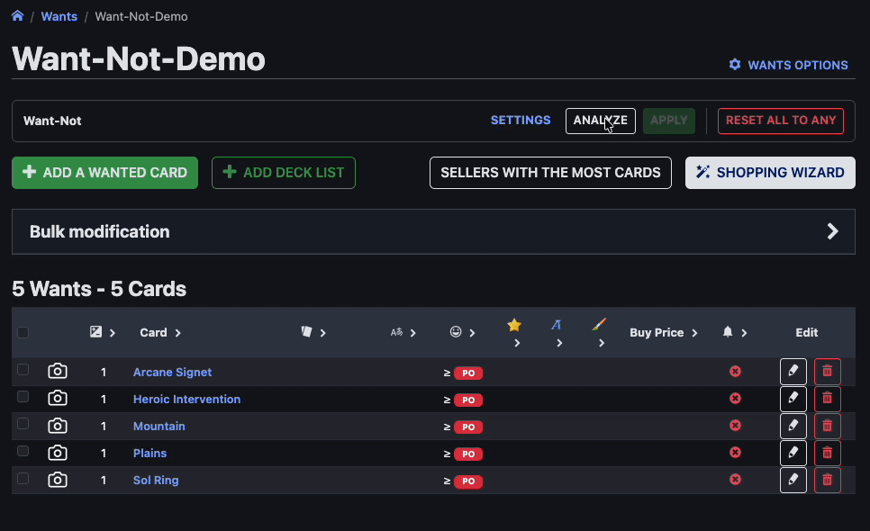
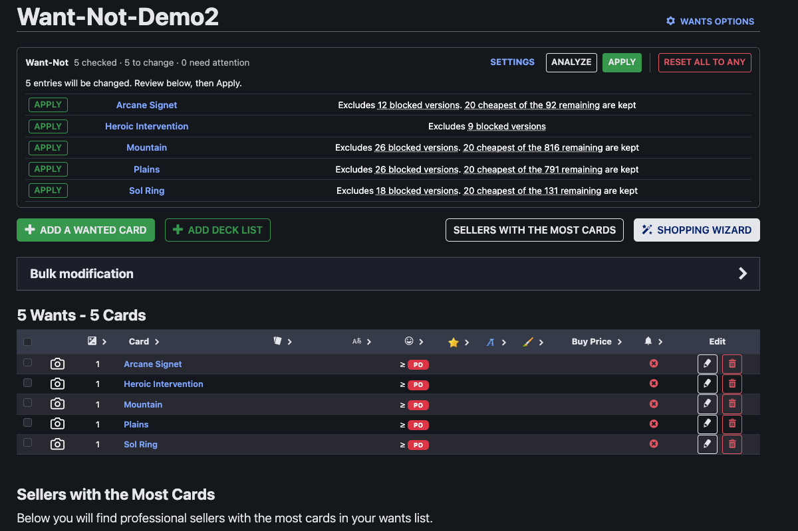
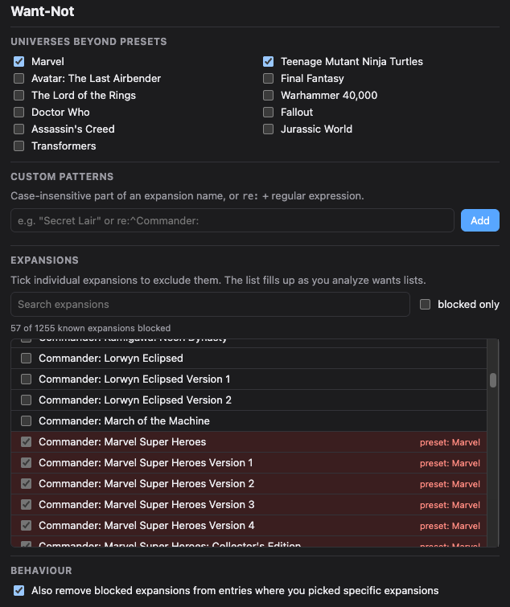

<p align="center"></p>

<h1 align="center">Want-Not for Cardmarket</h1>

<p align="center">
Keep the printings you don't want out of your Cardmarket orders.<br>
Exclude expansions like <b>Marvel</b> or <b>Teenage Mutant Ninja Turtles</b> from <i>every</i> card on a wants list — in one click.
</p>

<p align="center"></p>

---

## Why?

Cardmarket lets you pick the expansions you *want* for each card — but not the ones you *don't*.
If you'd rather not get Universes Beyond printings (or any other set) in a deck with a classic look,
you'd have to edit every single card by hand. Want-Not does that for you.

## Install

| Browser | |
|---|---|
| Chrome, Edge, Brave, Opera | [**Chrome Web Store**](https://chromewebstore.google.com/detail/want-not-for-cardmarket/cjckegenllnjjekaconmmanejaflhkdh) |
| Firefox | Firefox Add-ons — *coming soon* |
| Manual install | [Download the latest release](../../releases/latest) — see [manual installation](#manual-installation) |

## How to use

1. **Open one of your wants lists** on cardmarket.com. A small Want-Not panel appears below the title.
2. **Click _Analyze_.** Want-Not checks each card and shows what it would change. Nothing is changed yet.
3. **Click _Apply_** to update all cards, or _Apply_ next to a single card to update just that one.

That's it — the Shopping Wizard now ignores the excluded expansions.

<p align="center"></p>

### Choose what to exclude

Click the Want-Not icon in your browser toolbar (or *Settings* in the panel):

- **Presets** — one click per Universes Beyond franchise. Marvel and TMNT are on by default.
- **Custom patterns** — any part of an expansion name, e.g. `Secret Lair`.
  Power users can use a regular expression: `re:^Commander:`.
- **Expansion list** — tick individual expansions. The list fills up as you analyze your wants lists.

<p align="center"></p>

### Reset and undo

**Reset all to Any** sets every card on the list back to "any expansion". Your previous selections are
backed up, and **Undo reset** restores them.

## FAQ

**What exactly happens to a card?**

| Card on your list | What Want-Not does |
|---|---|
| Set to "Any", no excluded printing exists | Nothing — it stays "Any", so future reprints are still included |
| Set to "Any", some printings excluded | Selects all other printings |
| Specific expansions selected | Removes only the excluded ones (can be turned off in the settings) |
| Every printing is excluded | Nothing — the card is flagged so you can decide |

**Why are only 20 versions selected for some cards?**
Cardmarket allows at most 20 expansions per wants-list card. For cards with more printings
(Sol Ring, Counterspell, …) Want-Not keeps the 20 cheapest, based on Cardmarket's trend price.
Hover over the result to see which versions were left out.

**Can I exclude single Secret Lair drops?**
No — Cardmarket lists all Secret Lair cards under one expansion ("Secret Lair Drop Series"), so they
can only be excluded as a whole.

**Is it safe to use?**
Want-Not only does what you could do by hand: it opens each card's edit page and saves it, one card at
a time with a short pause, in your own logged-in session. It never touches your cart, orders or
account settings. Still, it is an unofficial tool that automates actions on Cardmarket — use it at your
own risk.

**What data does it collect?**
None. See the [privacy policy](PRIVACY.md).

## Manual installation

Only needed to try a version that isn't in the stores yet. Store installs update automatically.

**Chrome, Edge, Brave**
1. Download `want-not-<version>.zip` from the [latest release](../../releases/latest) and unzip it.
2. Open `chrome://extensions` and switch on **Developer mode** (top right).
3. Click **Load unpacked** and select the unzipped folder.

Manually installed extensions don't update automatically — repeat these steps for a new version.

**Firefox**
Firefox only installs signed add-ons permanently. Until Want-Not is on Firefox Add-ons you can load it
temporarily (until the next restart): open `about:debugging#/runtime/this-firefox`,
click **Load Temporary Add-on** and pick `manifest.json` from the unzipped folder.

## Development

No build step — the folder is the extension.

```sh
git clone https://github.com/AonyxCinerea/Want-Not-for-Cardmarket.git
cd Want-Not-for-Cardmarket
npm install       # test dependencies only
npm test          # unit tests against saved, anonymised Cardmarket pages
./scripts/build.sh  # creates dist/want-not-<version>.zip
```

| Path | |
|---|---|
| `src/content.js` | the panel on the wants list (analyze, apply, reset) |
| `src/parse.js` | reads Cardmarket's wants list and edit pages |
| `src/selection.js` | decides which expansions to keep |
| `src/blocklist.js` | presets and pattern matching |
| `src/background.js` | Scryfall price lookup |
| `options/` | settings page / toolbar popup |

**Releasing:** bump `version` in `manifest.json` (and `package.json`), commit, then push a matching tag:

```sh
git tag v0.3.1 && git push origin v0.3.1
```

GitHub Actions runs the tests, checks that the tag matches the manifest version, builds the zip and
publishes it as a [release](../../releases).

Contributions and bug reports are welcome. If Cardmarket changes its pages, please include the
page URL and what went wrong in the issue.

## License

[MIT](LICENSE). Not affiliated with or endorsed by Cardmarket. Price data from [Scryfall](https://scryfall.com).
Magic: The Gathering is a trademark of Wizards of the Coast.
